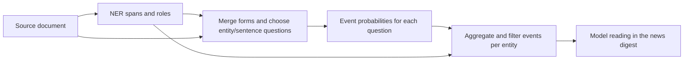

# News model training

This document explains what the news models learn, how their outputs become a document reading, and what evidence permits a model change. Runtime behavior belongs to [news models](../feature/watchlist-and-adverse-information.md#news-models); licensing and data boundaries belong to [ADR-0015](../adr/0015-licences.md) and [security and privacy](../feature/security-and-privacy.md). Training data, model files and detailed experiment records stay outside the repository.

For an existing checkout, use [taking over an existing checkout](#taking-over-an-existing-checkout) to identify the working changes, frozen data revision and preserved sources before executing tools.

## The system learns answers to two different questions

The NER model asks **which text spans name people or organisations, and what role each mention has**. The event model asks **which legal events a particular sentence states for the queried entity**. Recognising an event word, finding a name and assigning that event to the right person and case are separate tasks.

`OnnxNewsModel` supplies model inference. `NewsModelReading` chooses questions, merges forms and applies the runtime's entity/event rules. The digest is an attributed reading of the source; identity, source-condition and disposition decisions do not consume it.

The approved base is `bert-base-chinese`. The current NER label map has seven roles: `PER-Suspect`, `PER-Victim`, `PER-Official`, `PER-Other`, `ORG-Suspect`, `ORG-Victim` and `ORG-Other`, represented as BIO tags plus `O`. Canonical `PER-Witness` labels are merged into `PER-Other` by the training reader; a separately learned witness class is not currently available.

NER reads overlapping token windows. The retained candidate also learns document-level role biases from predicted mentions of the same source form. This can use an informative mention elsewhere in the document, but a person's overall role does not determine who owns a particular event or whether that event belongs to another case. Standalone NER acceptance uses final greedy spans with roles; runtime BIO decoding is evaluated through the complete pipeline.

The event model is a multi-label classifier. Its supported columns encode event types, certainty variants and `prior`. The ordinary input is `[CLS] form [SEP] marked sentence [SEP]`: crop 460 characters around the form, mark every occurrence of that form with IDs 1 and 2, then retain at most 512 tokens. Current NER inputs lowercase ASCII with an explicit model flag; ordinary event inputs retain their cased normalization. The two input modes must not be conflated.

### The question boundary controls what can be learned and found

Training preparation mirrors `NewsModelReading.Asked`: ask about a sentence containing an entity form; also carry one following sentence naming no person to the last-named person when that person is a suspect; and ask every suspect about each sentence that names no suspect (whole-case rows; in a judgment only the defendants listed before 主文). In documents with more than five suspects the label-free whole-case rows are sampled, about three per sentence, so they do not swamp training. The runtime also asks the unnamed suspects about a sentence naming one suspect for a group (等N人); no training row mirrors that yet. A gold event outside these questions contributes no event-training row. It can still be missed by the whole-document reader.

The runtime also merges forms, limits organisation events to applicable procedures and aggregates sentence probabilities per entity. A correct answer on an annotated row therefore does not guarantee a correct document reading. An extra NER entity can create extra questions and false events; a missed entity can prevent a correct event from being asked at all.

## Acceptance has three gates

All three gates must pass for the **same selected NER/event pair** on the fixed dev split. Each F1 must be strictly greater than 0.90.

| Gate | Unit being compared with gold | What remains in the denominator |
|---|---|---|
| Primary NER | Exact span boundaries **and role**, using the acceptance scorer's greedy decoding | All 3,031 original gold spans in 161 dev documents |
| Primary event | Label decisions on prepared entity-form/sentence rows | All 2,642 dev rows and 690 gold labels; unsupported gold labels count as FN |
| Actual end to end | `(document, gold person, event label)` through `OnnxNewsModel` and `NewsModelReading` | All 418 gold events in 161 documents; events on unlabelled entities count as FP |

`F1 = 2TP / (2TP + FP + FN)`. The strict gate is checked with integer counts: `2TP > 9(FP + FN)`. A rounded display of `0.90` is insufficient. Boundary-only NER scores, BIO-constrained diagnostics, training fit and masked-language-model loss answer other questions and cannot replace these gates.

The primary event threshold is selected on dev over 0.05–0.95 in 0.025 increments. End-to-end calibration uses the runtime's effective 0.30 floor through 0.95 at the same increments. An outer evaluator threshold below the runtime floor cannot recover already-filtered outputs. Recount a probability dump first, then confirm its selected optimum through the actual .NET evaluator. Calibration is separate from a learned improvement.

Train is used for optimization, dev for checkpoint/threshold selection, and test for final validation. Keep split identities and held-out gold fixed during this improvement loop. Add eligible new sources to train only, excluding duplicate and related held-out material. If train labels change, compare both candidates on the same evaluation revision. Earlier test results belong to their historical model/data revisions; they do not validate the retained candidates. Final test remains reserved until all three dev gates pass together, then uses frozen model identities and dev-selected thresholds.

## Current candidate choice

The verified development choice as of 2026-11-15 is **NER20 / event27**. It has not replaced deployed models.

| Measure | Selected candidate | TP / FP / FN | Dev F1 | Threshold | Gate |
|---|---|---|---|---|---|
| Primary NER | NER20 with ASCII input mode and document-role head | 2,791 / 265 / 240 | 0.917036 | — | Pass |
| Primary event | event27, ordinary CLS input/output | 495 / 124 / 195 | 0.756303 | 0.275 | Fail |
| Actual end to end | NER20 / event27 | 344 / 78 / 74 | 0.819048 | 0.30 | Fail |

An overall passing NER score does not establish reliable rare roles: `ORG-Victim` has zero TP on six dev gold spans. The retained pipeline still has 17 FP on unlabelled names and four FN from people without a matched entity. Model-role accuracy and event attribution both matter to the final reading.

The latest shared predicate decoder candidate has primary F1 0.754938 and actual pipeline F1 0.812428, so it does not replace the retained pair. The five source-reviewed motivating actor/case errors remain wrong. Current selection and limitation summaries belong here; epoch histories, process IDs, upload progress and individual retry records belong to the external artifacts.

## Diagnose an error at the boundary where it arises

Start with the source and canonical label, then trace the exact runtime question and retained token IDs. The following distinctions determine which correction would address the error.

| Question | Evidence to inspect | Consequence for a correction |
|---|---|---|
| Is the gold statement correct for this person, event, certainty and case? | Canonical annotation and source-reviewed ownership/scope | Correct confirmed label errors before training; a structural checker alone cannot certify semantics |
| Does the reader ask the necessary question? | `Asked`/`prep.py` parity and entity matching | Missing questions or entities require preparation/runtime or NER work; an event-loss change cannot create them |
| Does the model receive the distinguishing information? | Actual cropped IDs, segments, markers, normalization and source context | Repair demonstrated information loss while preserving offsets and label alignment |
| Does available context belong to the queried person and case? | Clause ownership, quoted statements, current/other-case references and retained context | Event-word detection and a global suspect role are insufficient; verify the relation itself |
| Does the model fit train but fail on dev? | Full-train and dev counts on their recorded revisions; error groups and case coverage | Investigate generalization and supervision coverage before proposing more epochs or a loss weight |
| Does a new component actually affect served predictions? | Gradients, zero-effect compatibility, controlled interventions and native/ONNX/.NET parity | Establish implementation correctness separately from semantic improvement |

### What the existing evidence establishes

**Exact input collisions are a small limit.** Actual encoded ordinary, masked and caption views give an optimistic dev bound of 0.998549. Only four FP and zero FN of retained event27 fall on ambiguous label cells. The bound measures contradictions in identical inputs; it is neither attainable performance nor proof that each input contains sufficient case context.

**The event gap includes generalization.** On its recorded train revision, event26 fits train at F1 0.979608 and `prior` at 412/415 TP, while dev `prior` remains 26/83 TP. This rules out broad failure to fit those training labels, without identifying a unique cause. Negative-label prevalence alone likewise does not establish that loss weighting will repair the errors.

**Case-pattern supervision is sparse in the actual model views.** A bounded literal probe finds no prior-positive train row retaining a named-case alias, compared with 17 such dev positives. A witness-prefix probe finds only two train prior positives and five dev positives. These overlapping lexical groups are inspection aids, not rules for assigning `prior`. Replacing a reviewed other-case alias with an explicit other-case term did not improve full-dev F1. Six non-identical cached but unadopted sources also have no named-case alias probe hits; their eligibility and independent annotation review remain incomplete.

**Connected components can still learn the wrong relations.** Frozen document-context heads use their added inputs, yet retain the reviewed actor/case errors. A source-caption observation also changes probabilities without repairing those cases. Trigger-binding supervision already updated the main encoder; it was not a frozen-encoder bug. Its older event25 experiment saved an epoch-zero selection and did not retain the final trained weights, so inspecting that saved initial head cannot explain its trained-epoch behavior. Sharing predicate-token scores between the primary output and binding loss verifies that the supervised scores are served, but still leaves all five motivating errors wrong. Thus neither adding context nor connecting an auxiliary objective is, by itself, a checked semantic repair.

These findings support continued work on person/event/case relations and train-only coverage. They do not establish that one vocabulary change, wider crop, threshold adjustment or parameter combination is the remaining solution. A proposed correction needs a source-verified failure mechanism and a test that distinguishes repaired behavior from merely changed confidence.

## Treat a candidate as a complete inference contract

A candidate consists of weights, feature configuration, label maps, tokenizer behavior, learned heads, runtime behavior and its evaluation revision. A weights filename alone does not identify the predictions.

| Boundary | Invariant |
|---|---|
| Preparation → training | Preserve row identities, labels, order and split provenance. Use every original primary row, including negatives and rows without auxiliary supervision |
| Feature mode → inference | Normalization, crop, markers and document-derived observations must agree in Python and .NET. An effective input change needs a compatibly trained checkpoint and measured parity; compare actual IDs rather than treating serialization-only JSON differences as a new tokenizer |
| Training → evaluation | Explicitly enable training/dropout for optimizer batches; preserve mode across dev evaluation. No dev augmentation. Check real finite gradients and parameter updates |
| Auxiliary supervision → primary task | Unknown/ambiguous trigger ownership supplies no auxiliary target; it does not turn a primary positive into a negative or remove its row |
| Checkpoint → report | Record the selected epoch, epoch-zero baseline and actual final trained weights separately. Selection of epoch zero is not trained improvement |
| Native → ONNX → .NET | Compare real short/long inputs, padding and boundary cases, outputs and exact tokenizer IDs. Test the complete runtime path, not only a synthetic export |
| Model → cache | Bind caches to model/config/feature identity. Document-dependent event modes also require the source-document identity; a pair-only key cannot represent them |

The retained event model uses ordinary CLS pooling. Experimental contracts are available for document-context heads, literal caption observations and query-conditioned predicate-token pooling. Their flags and graphs describe different computations; the runtime support does not make them selected models. The predicate decoder uses existing BERT/pooler/classifier parameters, excludes query/name/delimiter/padding positions from the predicate pool, and retains a fallback for an empty pool. Its training-only trigger bindings are conservative source alignments, not runtime gold inputs.

Native event inference goes through `event_pooling.event_logits`, which dispatches the saved pooling mode. Loading ordinary `BertForSequenceClassification` weights and calling its default forward does not automatically apply an AML-specific decoder. `export_one.py` uses the matching export wrapper; the generic .NET graph runner then executes the exported computation.

Known unsuccessful mechanisms remain evidence against repeating an unchanged proposal. Preserve their immutable sources and results, and state what new observation would make a materially different experiment informative.

## From a diagnosis to a reviewable model change

1. **Validate the source and proposed correction.** Annotate → independent verify → targeted sweep use different subagents under the authorized review scope; every label file passes `check.py`. Preserve source fingerprints and resolved disagreements. Apply confirmed train corrections before rebuilding. Reports contain anonymous document/party IDs and counts, never source names or quotations.
2. **Freeze the comparison.** Record starting weights, exact train/dev inputs, label maps, split and code hashes, settings and the intended failure cases. Reproduce the parent's complete dev counts before optimizer creation. When a feature mode changes, measure its untrained initialization separately from the ordinary parent.
3. **Exercise the real path.** Check the actual tiny training entry, gradient paths, save/reload, row retention, unsupported-label misses and export/runtime parity. An isolated real-GPU preflight proves finite updates, active training/dropout and unchanged parent/input files before formal optimization. Synthetic learning validates machinery, not task F1.
4. **Train and preserve artifacts.** Optimize on train and choose on fixed dev. Save per-epoch probabilities with gold/label order, selected and last-trained checkpoints, logs, sources and manifests. Keep exactly one backup watcher covering the job before launch.
5. **Decide on measured behavior.** Independently reload and score the selected model; compare identical gold arrays, recovered/lost TP and removed/added FP. Export and evaluate the actual paired .NET reader with an isolated cache, then confirm the dev optimum. Revisit the motivating source errors. Retain the better measured candidates, and accept a pair only when all three gates pass. Deployment is a separate action.

The next experiment follows from unresolved evidence. A low aggregate score or a stagnant sequence of runs does not, on its own, justify another epoch/learning-rate/loss trial.

### Colab is temporary execution, not durable storage

The existing `colab` Docker container mounts `C:\tmp\aml-train` as `/train` and `C:\tmp\colab\home` as `/home/colab`. The launcher stages an immutable job containing only the permitted inputs and pins the tested environment in `run.sh`. No task-test input is uploaded. Credentials stay in the container's existing keyring; agents never print, copy or handle sign-in secrets.

`launch_next.py`, `monitor_training.py` and `backup_remote.py` form the launch/backup protocol. A new trainer must be recognized as a live worker and included in the explicit watch targets and archive contents. Completed artifacts return in 40 MB parts; verify size and SHA-256 before joining/extraction, record local verification, then stop the VM. Inspect selected/last weights, sources and epoch arrays independently. Interrupted snapshots and aborted jobs retain distinct receipts and must not masquerade as completed results.

A local observation timeout is not evidence that training ended. Recheck the same worker/session and advancing steps rather than starting a replacement job. An interim checkpoint backup needs its own identity and must not set the final completion/stop markers. Preserve existing job directories and manifests when preparing another experiment.

## Where the artifacts and entry points live

All paths in this section are outside the repository. They distinguish source truth, derived inputs, candidate artifacts and deployed files; directories named `models\ner` or `models\ev` are not sufficient evidence of which candidate was selected.

| Responsibility | Location |
|---|---|
| Source texts | `C:\tmp\aml-data\judgments\`, `press\`, `news\` |
| Canonical labels | `C:\tmp\aml-data\labels\v6\ver`, `v6\npa\fin`, `v7\ver` |
| Annotation guideline/checker | `C:\tmp\aml-data\labels\tools\guideline.md`, `check.py` and review prompts |
| Fixed splits and derived model rows | `C:\tmp\aml-train\data\split.json`, `ner-{train,dev,test}.jsonl`, `ev-{train,dev,test}.jsonl` |
| Preparation, trainers, native scorers and Python checks | `C:\tmp\aml-train\`; interpreter `.venv\Scripts\python.exe` |
| Colab staging, launcher and watcher | `C:\tmp\colab\home\`; immutable `jobN\` bundles |
| Downloaded weights/logs and verification receipts | `C:\tmp\aml-train\downloads\colab-20261114\` |
| Metrics, diagnostic arrays and isolated runtime pairs | `C:\tmp\aml-train\measurements\` |
| Immutable executed source snapshots | `C:\tmp\aml-train\snapshots\` |
| Actual .NET evaluator | `C:\tmp\aml-eval\Program.cs`, `bin\Release\net10.0\aml-eval.dll` |

The retained native NER is `downloads\colab-20261114\aml20\ner\extracted\models\ner`; it requires both its encoder and `document-roles.safetensors`. The retained native event model is `downloads\colab-20261114\aml27\ev\extracted\models\ev`. Their verified ONNX/config/vocab pair and isolated caches are under `measurements\aml27-pair\`. These paths are relative to `C:\tmp\aml-train`.

Deployment supplies the matching `ner/` and `ev/` graphs, configs, vocabularies and required heads at `NewsModels:Directory`. Update the product's measured behavior with the deployed pair. A change to `NewsModelReading.EventThreshold` changes the inference contract and requires actual runtime evaluation as well.

| Task | Existing entry point and boundary |
|---|---|
| Rebuild derived inputs | `prep.py`; preserve fixed splits and use guarded train-only rebuilds for train label revisions |
| Verify a completed download | `verify_completed_run.py <job> <model>`; `--check-only` validates without rewriting a historical receipt |
| Score native dev models | `measure_dev.py <model> <checkpoint> <out>`; `measure_query_dev.py` supplies the predicate mode's sorted/restored native batching |
| Export a checkpoint | `export_one.py <checkpoint> <out>`; verify graphs, config and vocabulary together, including required learned heads |
| Evaluate the whole reader | Release `aml-eval.dll <pair> dev cached e2e min=<threshold> cache=<isolated-cache> idsref=<reference> dump=<file>` |
| Calibrate the pipeline | `calibrate_e2e.py <pair>`; actual .NET confirmation follows its dump recount |
| Final per-model test | `measure_dev.py <model> <checkpoint> <out> --split test --dev-metrics <passing-record>`; use only after all three dev gates pass |

Here `<model>` is `ner` or `ev`. Run Python tools from `C:\tmp\aml-train` and the .NET evaluator from `C:\tmp\aml-eval`; the latter uses `dev.jsonl` derived from the same fixed dev revision. Preserve the repository SDK pin when building the external evaluator. Shell commands follow the repository's RTK instruction.

New end-to-end probability dumps contain numeric fields, anonymous IDs and an empty quote column; unknown entity IDs are hashed per document. Working inference caches still contain private input text and stay outside the repository. Reuse a NER cache only under matching NER/input/role-head identities. Event changes start with a fresh isolated cache; document-dependent modes include the document in their key.

## Taking over an existing checkout

The handoff has three parts: the repository implementation and documentation, the machine-local training workspace, and immutable experiment evidence. Preserve all three. A Git clone alone does not reproduce this workspace.

### Implementation map

| Responsibility | Files to inspect | What the next agent must preserve |
|---|---|---|
| Forward the source to document-aware models | `src/Aml.Core/Ports/INewsModel.cs`, `src/Aml.Core/Explanation/NewsModelReading.cs` | The document-aware overload and legacy pair-only compatibility; source text is an inference input, not a new decision input |
| Execute configured feature modes and learned heads | `src/Aml.Infra/Models/OnnxNewsModel.cs` | ASCII normalization/offset parity, document roles, event context/caption contracts, version identity and rejection of invalid combinations |
| Guard the runtime contracts | `tests/Aml.Tests/Unit/Extraction/NewsModelTokensTests.cs`, `tests/Aml.Tests/Unit/Screening/NewsModelReadingTests.cs` | Token/offset, role adjustment, context/anchor/caption behavior and forwarding the same document |
| Build and measure candidates | External `train_ner_document.py`, `ner_document.py`, `train_ev_reviewed.py`, `train_query_predicates.py`, `query_predicates.py`, `event_pooling.py`, `measure_dev.py`, `export_one.py` | The selected model's complete native/export/runtime contract and fixed scoring definitions |
| Preserve results | External Colab launcher/watcher and the .NET evaluator | Verified backups before stopping the VM, separate selected/last checkpoints, source-aware caches and anonymous report output |

The repository files above belong to the handoff commit. Inspect `git log`, `git status` and any remaining diff before editing, and preserve later local changes. Training scripts, data, models and receipts under `C:\tmp\` are outside Git. An agent on another machine needs those workspaces transferred separately; never include credentials in that transfer.

### Frozen state to establish before another experiment

The retained pair is NER20/event27 from the candidate table. The latest completed candidate is event29; its selected checkpoint is trained epoch 2, its final trained checkpoint is epoch 3, and both are preserved. Both event28 and event29 failed to set a new primary or pipeline best. All completed jobs through 29 are locally backed up and stopped; the server had no active Colab session at handoff. Recheck live state before managing sessions. No job30 has been launched and no checked next correction is ready.

Current train data contains 34,593 event rows and 6,182 gold labels. The canonical review of the original 24 judgments, the focused Questioning correction and the additional 21 judgments has been applied and independently verified. The four unresolved `also` groups remain unapplied. These are completed adoption records, not a pending queue to apply again; no further gold error is currently confirmed. Inspect `measurements\review24-inputs\`, `measurements\review21-inputs\` and `C:\tmp\aml-data\labels\review-questioning-20261115\` for the adoption/impact/rebuild proofs. `verify_questioning21_rebuild.py` shows the temporary, train-only guarded reproduction; it writes a validation receipt and must not be mistaken for a tool with no writes. Preserve frozen receipts when reproducing a check.

The current identity anchors are:

| Input | SHA-256 |
|---|---|
| `data\ev-train.jsonl` | `5e565a835ab6fa729289640bd93642cea6d9fdb9d1593e1894b21b2986927d70` |
| `data\ev-dev.jsonl` | `5ac402da9429e565e1eb7b5c22d7327f0c746579b5fe7619d32bbc7a12c581c8` |
| `data\split.json` | `c43ac736aecd1dd1ddaeb01006adda58fe5fc69218da7befd5a9808e70da6227` |

Paths above are relative to `C:\tmp\aml-train`. Treat old appliers and experiment launchers as historical programs: inspect their side effects and pinned inputs before execution. In particular, generic preparation and older experimental trainers may rebuild held-out files or read test automatically. Resume with identity/receipt checks and source-error diagnosis; a new run needs the correction and validation described above. The small failing-case set and literal coverage groups are in `measurements\aml29-ev\actor-case-diagnostics.json`.

### Reproduce evidence without relying on this conversation

`C:\tmp\aml-train\snapshots\query-predicate-completed-20261115\snapshot.json` indexes 52 preserved executed-source and receipt files with SHA-256, including Python training/scoring/export, Colab scripts and both external .NET checkers. The snapshot's documentation is historical; this repository document supplies the current conceptual guidance. Its completion receipt binds the downloaded models and the actual selected/last/native/ONNX/.NET comparisons. Earlier retained candidates keep their own downloaded sources and receipts.

Python uses `C:\tmp\aml-train\.venv\Scripts\python.exe`; agent shell commands use RTK as specified in `AGENTS.md` and `C:\Users\a8022\.codex\RTK.md`. The repository pins .NET SDK 10.0.303; this host currently has 10.0.301 but not 10.0.303. The external evaluator can be built from `C:\tmp\aml-eval` with the installed SDK without changing `global.json`. A preserved full solution validation records 1,068 passing tests and a zero-warning Release build. Its `dotnet_tests.log` and `release_build.log` are under `measurements\caption-validation\checks\`; their hashes are in `measurements\caption-validation\reviewed-inputs\reviewed-training-validation.json`. These files document that validation; recheck the appropriate tests after code changes.

Continue by validating a concrete correction to the unresolved person/event/case errors, using the evidence below. Preserve the passing NER candidate and the untouched final-test boundary while doing so. Documentation updates replace the current model/decision summary or refine the explanation; execution details remain in their artifacts.

### Evidence index

These are durable references for conclusions above, not a second execution log. Paths below are relative to `C:\tmp\aml-train\measurements` unless stated otherwise.

| Question | Evidence |
|---|---|
| Which candidates and actual pipeline are retained? | `aml20-ner\ner-dev-metrics.json`, `aml27-ev\ev-dev-metrics.json`, `aml27-pair\e2e-dev-metrics.json` |
| Is the event gap mostly identical-input contradictions? | `input-identity-audit\encoded-conflicts.json` |
| Does the model fit the recorded training revision? | `aml26-ev\train-fit-diagnostic.json` and its probability array |
| What case-pattern coverage is missing? | `input-identity-audit\case-frame-coverage.json`, `input-identity-audit\named-case-alias-intervention.json`, `input-identity-audit\uncatalogued-literal-coverage.json` |
| Does adding document context solve attribution? | `aml21-ev\context-head-analysis.json`; context variants in `aml22-ev\` and `aml23-ev\` |
| Was trigger supervision disconnected or the saved checkpoint actually trained? | `aml25-ev\completion-analysis.json`; archived trainer/logs under `C:\tmp\aml-train\downloads\colab-20261114\aml25\ev\` |
| Does the literal caption observation repair case relations? | `aml28-ev\completion-analysis.json`, `aml28-last-ev\caption-intervention.json` |
| Does serving the supervised predicate score repair them? | `aml29-ev\completion-analysis.json`, `aml29-ev\actor-case-diagnostics.json`; implementation checks in `query-predicate-validation\` |
| Are the model/data/runtime identities reproducible? | Each job's `job.json`, `VERIFIED.json`, `artifact-validation.json`, GPU receipt and per-epoch arrays; executed-source snapshots under `C:\tmp\aml-train\snapshots\` |

The licence review covers both replacement weights and their training corpora. Metadata reviews under `C:\tmp\aml-train\candidate-review\macbert-base\` and `C:\tmp\aml-train\candidate-review\bert-wwm\` do not constitute approval or a base-model replacement; ADR-0015 remains the decision in force.
