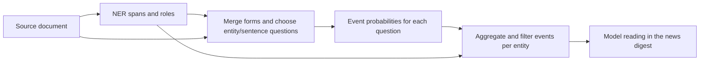

# News model training

This document explains what the news models learn, how their outputs become a document reading, and what evidence permits a model change. Runtime behavior belongs to [news models](../feature/watchlist-and-adverse-information.md#news-models); licensing and data boundaries belong to [ADR-0015](../adr/0015-licences.md) and [security and privacy](../feature/security-and-privacy.md). Training data, model files and detailed experiment records stay outside the repository.

For an existing checkout, use [taking over an existing checkout](#taking-over-an-existing-checkout) to identify the working changes, frozen data revision and preserved sources before executing tools.

## The system learns answers to two different questions

The NER model asks **which text spans name people or organisations, and what role each mention has**. The event model asks **which legal events a particular sentence states for the queried entity**. Recognising an event word, finding a name and assigning that event to the right person and case are separate tasks.

`OnnxNewsModel` supplies model inference. `NewsModelReading` chooses questions, merges forms and applies the runtime's entity/event rules. The digest is an attributed reading of the source; identity, source-condition and disposition decisions do not consume it.

The approved base is `bert-base-chinese`. The current NER label map has seven roles: `PER-Suspect`, `PER-Victim`, `PER-Official`, `PER-Other`, `ORG-Suspect`, `ORG-Victim` and `ORG-Other`, represented as BIO tags plus `O`. Canonical `PER-Witness` labels are merged into `PER-Other` by the training reader; a separately learned witness class is not currently available.

NER reads overlapping token windows. The retained candidate also learns document-level role biases from predicted mentions of the same source form. This can use an informative mention elsewhere in the document, but a person's overall role does not determine who owns a particular event or whether that event belongs to another case. Standalone NER acceptance uses final greedy spans with roles; runtime BIO decoding is evaluated through the complete pipeline.

The event model is a multi-label classifier. Its supported columns encode event types, certainty variants and `prior`. The ordinary input is `[CLS] form [SEP] marked sentence [SEP]`: crop 460 characters around the form, mark every occurrence of that form with IDs 1 and 2, then retain at most 512 tokens. Current NER inputs lowercase ASCII with an explicit model flag; ordinary event inputs retain their cased normalization. The two input modes must not be conflated.

### The question boundary controls what can be learned and found

Training preparation mirrors `NewsModelReading.Asked`: ask about a sentence containing an entity form; also carry one following sentence naming no person to the last-named person when that person is a suspect; and ask every suspect about each sentence that names no suspect (whole-case rows; in a judgment only the defendants listed before 主文). In documents with more than five suspects the label-free whole-case rows are sampled, about three per sentence, so they do not swamp training. The runtime also asks the unnamed suspects about a sentence naming one suspect for a group (等N人), and about any other sentence naming a suspect for investigation and referral only; no training row mirrors either yet. A gold event outside these questions contributes no event-training row. It can still be missed by the whole-document reader.

The runtime also merges forms, limits organisation events to applicable procedures and aggregates sentence probabilities per entity. A correct answer on an annotated row therefore does not guarantee a correct document reading. An extra NER entity can create extra questions and false events; a missed entity can prevent a correct event from being asked at all.

## Acceptance has three gates

All three gates must pass for the **same selected NER/event pair** on the fixed dev split. Each F1 must be strictly greater than 0.90.

| Gate | Unit being compared with gold | What remains in the denominator |
|---|---|---|
| Primary NER | Exact span boundaries **and role**, using the acceptance scorer's greedy decoding | All 3,031 original gold spans in 161 dev documents |
| Primary event | Label decisions on prepared entity-form/sentence rows | All dev rows the current asking rules produce (8,050 rows, 1,194 gold labels); unsupported gold labels count as FN |
| Actual end to end | `(document, gold person, event label)` through `OnnxNewsModel` and `NewsModelReading` | All gold events of the 161 dev documents; events on unlabelled entities count as FP |

`F1 = 2TP / (2TP + FP + FN)`. The strict gate is checked with integer counts: `2TP > 9(FP + FN)`. A rounded display of `0.90` is insufficient. Boundary-only NER scores, BIO-constrained diagnostics, training fit and masked-language-model loss answer other questions and cannot replace these gates.

**The unit of the working end-to-end measure is the written name.** Day-to-day comparisons score every annotated event of the dev documents and of the second dev set, at the runtime floor of 0.30. The reader's answer is per written name, so two rules decide who a read name is:

- a read name that is a fragment of exactly one annotated person's written form counts as that person;
- annotated persons whose written form is identical in the same document (two masked names written alike) are one name, and their gold events are the union. Nothing in the name tells them apart, and scoring them apart counts one unavoidable miss and one unavoidable false positive per event. Persons the text does tell apart, for example by a bracketed role after the same surname, stay separate.

On the pair retained when the rule was introduced this second rule alone moves the working F1 from 0.811 to 0.826 on the dev documents and from 0.854 to 0.859 on the second set. That is a change of measure, not of the models: compare a number only with numbers scored the same way.

The primary event threshold is selected on dev over 0.05–0.95 in 0.025 increments. End-to-end calibration uses the runtime's effective 0.30 floor through 0.95 at the same increments. An outer evaluator threshold below the runtime floor cannot recover already-filtered outputs. Recount a probability dump first, then confirm its selected optimum through the actual .NET evaluator. Calibration is separate from a learned improvement.

Train is used for optimization, dev for checkpoint/threshold selection, and test for final validation. Keep split identities and held-out gold fixed during this improvement loop. Add eligible new sources to train only, excluding duplicate and related held-out material. If train labels change, compare both candidates on the same evaluation revision. Earlier test results belong to their historical model/data revisions; they do not validate the retained candidates. Final test remains reserved until all three dev gates pass together, then uses frozen model identities and dev-selected thresholds.

## Current candidate choice

The verified development choice as of 2026-11-21 is **NER20 / event43**. It has not replaced deployed models.

| Measure | Selected candidate | TP / FP / FN | Dev F1 | Threshold | Gate |
|---|---|---|---|---|---|
| Primary NER | NER20 with ASCII input mode and document-role head | 2,791 / 265 / 240 | 0.917036 | — | Pass |
| Primary event | event43, ordinary CLS input/output | 963 / 259 / 231 | 0.797185 | 0.40 | Fail |
| Working end to end, dev documents | NER20 / event43 | 511 / 100 / 62 | 0.863176 | 0.30 | Fail |
| Working end to end, second dev set | NER20 / event43 | 353 / 52 / 38 | 0.886935 | 0.30 | Fail |
| Profile person, dev documents (176 persons) | NER20 / event43 | 457 / 128 / 43 | 0.842396 | 0.30 | — |
| Profile person, second dev set (125 persons) | NER20 / event43 | 295 / 76 / 6 | 0.877976 | 0.30 | — |

The two Profile-person rows measure the reading the way the system uses it: one known person per news item. Each labelled suspect person in turn is the Profile person (all their written forms are the Profile's names; persons sharing a form are one), the reader is run with those names, and only the entities it marks as the Profile's are counted. The legal stage those events imply (the highest of convicted, acquitted, not indicted, indicted, wanted, alleged, none; earlier-case, negated and requested steps left out) agrees with the labels for 157 of 176 persons (0.892) and 122 of 125 (0.976); whether the person has any step at all agrees for 169 (0.960) and 125 (1.000). This view has no gate. It is harsher on precision than the working measure (persons with no labelled event are included: 41 and 16) and it rotates only over labelled suspects, so it says nothing about a Profile person the text mentions as a victim or an official.

The event rows are those of the current asking rules (8,050 dev rows), so the primary event counts are not comparable with candidates measured on earlier row sets. The end-to-end rows use the working measure defined above, not the gate's form (one gold person per cell, without the two name rules); the gate form has not been re-measured for event43, and both working rows are already short of 0.90. The second dev set is 29 documents that are never used for training. Thresholds and reader rules were chosen looking at the dev sets, so neither is an untouched estimate; the test split is.

event43 is event37 trained for one more epoch with rows of a kind of text the training documents do not hold: a news report of a court ruling. The training text is judgments and police and prosecutor releases, and on a media court report event37 read an appealable ruling (可上訴, 得上訴) as an appeal and a dated earlier step of the same case as an earlier case. The training labels were checked first and are right: no appeal label stands on a sentence whose only appeal wording is appealability, but only 33 such sentences exist, all in other kinds of text. The added rows are 539 questions on made-up sentences of that kind (rulings with appealability wording, dated earlier steps of the same case, earlier records with contrasts), written to a brief by three writers, labelled blind by two others and adjudicated, each repeated four times beside the 173,941 existing rows. On 170 held-out rows from made-up reports by a fourth writer who did not see the others, row-level F1 at 0.30 rose from 0.761 (142 / 43 / 46) to 0.864, and wrong earlier-case answers fell from 18 to 8. On the real dev sets event43 has 252 errors against 263 for event37 (0.854 / 0.884, 501 / 99 / 72 and 352 / 53 / 39); a control that trained the same extra epoch without the made-up rows has 260 (0.856 / 0.881), so the epoch alone does not explain the gain. The Profile-person stage agreement is the same as event37's and its events are better (0.832 → 0.842, 0.876 → 0.878). One run each.

Official court press releases, a third kind of text (a court's own summary of its ruling), do not help as training rows. 40 releases of the Judicial Yuan's court news (government news releases, Copyright Act art. 9) were labelled and verified the way the training documents are; 32 give 1,948 rows and 8 are held out (380 rows, 56 labels). On the held-out rows event37 scores 0.735 and event43 0.727, far below the dev sets. event44 (event43 plus one epoch with the 32 releases' rows twice) scores 0.742 there, with 24 of its 29 wrong rows the same as event43's, and ties event43 on the working measure (0.865 / 0.884, 251 errors against 252) while agreeing on the legal stage for three fewer Profile persons (156 and 120). It is not retained. What stays wrong in the releases is not wording a sentence model can learn from more rows: a sentence that says only 被告 is asked about every named person, including the principal offender or co-actor of another case who is not this ruling's defendant, and the gathered PDF text breaks sentences at line ends so that the name and the sentence stand in different rows. Both are properties of the reading and the gathered text, to be corrected there before more releases are labelled.

event37 continues the ordinary CLS line: the job35 event model (see the frozen state below) trained for one more epoch at a low learning rate on the same rows. A second arm of that continuation wrapped the other persons of the sentence in a second marker pair; it ended with 271 errors over both sets (0.854 / 0.877) against 276 for event37 (0.848 / 0.877 under the reader rules of that time), one run each. That difference does not show an effect of the markers, the marked input needs a change to the served input, and it was not kept. Both arms improve on their common start (294 errors), which is what one more epoch gave.

Where the remaining end-to-end errors sit was checked with a second, unrelated event model: the same rows trained on the multilingual ModernBERT encoder `jhu-clsp/mmBERT-base` for two epochs (row-level dev F1 0.818 at 0.35, 0.825 at its best threshold; end to end 0.872 / 0.881 with every reader rule unchanged, before the rule below). That encoder is a measurement only and is not a candidate: its weights are MIT, but its pre-training text is mostly web crawl whose sources' terms are not shown to allow commercial use, and its tokenizer comes from a model under separate terms, so it does not meet [ADR-0015](../adr/0015-licences.md). A survey of about twenty other encoders found none that is both stronger than `bert-base-chinese` and trained only on identified, commercially usable text. The two models share 173 errors (same person, same step, wrong the same way). Two blind readings of the whole document, a third for the 21 they disagreed on, and a check of each flagged item against text and guideline changed one dev label (an organisation given a whole-case investigation it is not said to be under); the rest stand. Of the 70 confirmed shared misses, 54 are steps stated only by a whole-case or group sentence, and about 32 of those were lost in the reader rather than the model: the question was never asked, or the answer was dropped by a rule. Reading a sentence that names one suspect for the others too, for investigation and referral only, recovered four events on each dev set, for three wrong ones on the dev documents and one on the second set (0.849 → 0.851 with the corrected label, which alone moved 0.848 to 0.849; 0.877 → 0.881; the table above). Accepting other steps from whole-case sentences in a large case when the model is very sure was measured and left out: at 0.9 it adds 26 wrong events to the second dev set for none found (0.853), at 0.98 six (0.875). Of the 59 confirmed shared extra events, 39 come from whole-case questions and 20 from sentences naming the person.

Whether fixed rules can correct the model's answers was measured on the dev rows with a list of step words taken from the training labels' triggers. Dropping an answer whose sentence holds no word of its step lowers row-level F1 (0.814 → 0.790): 203 of 236 extra answers do hold the word. Adding a step wherever its word stands would add 3,520 wrong answers for 134 right ones. The errors are about whose step it is and which case, not about whether a step is written, so word rules do not help. Structure helps only where the text has a fixed form: a judgment's order. Reading it by rule and letting it decide the fine and confiscation of each defendant it sentences or acquits removed five wrong events on the dev documents and three on the second set (501 / 104 / 72 → 501 / 99 / 72, 352 / 56 / 39 → 352 / 53 / 39; the table above); adding the steps the order states to the model's found nothing more and is left out. The remaining judgment errors (about 55 extra and 22 missed on the dev documents) are steps the order does not settle: arrests, detention, indictment, earlier cases, appeals.

An overall passing NER score does not establish reliable rare roles: `ORG-Victim` has zero TP on six dev gold spans. Model-role accuracy and event attribution both matter to the final reading.

Structural candidates measured so far (document-context heads, trigger-binding supervision, caption observation, shared predicate decoder, clause-level rows, other-person markers) did not replace the ordinary CLS line. The five source-reviewed actor/case errors that motivated the earlier structural work have not been re-checked against the current candidate. Current selection and limitation summaries belong here; epoch histories, process IDs, upload progress and individual retry records belong to the external artifacts.

## Diagnose an error at the boundary where it arises

Start with the source and canonical label, then trace the exact runtime question and retained token IDs. The following distinctions determine which correction would address the error.

| Question | Evidence to inspect | Consequence for a correction |
|---|---|---|
| Is the gold statement correct for this person, event, certainty and case? | Canonical annotation and source-reviewed ownership/scope | Correct confirmed label errors before training; a structural checker alone cannot certify semantics |
| Does the reader ask the necessary question? | `Asked`/`prep.py` parity and entity matching | Missing questions or entities require preparation/runtime or NER work; an event-loss change cannot create them |
| Does the model receive the distinguishing information? | Actual cropped IDs, segments, markers, normalization and source context | Repair demonstrated information loss while preserving offsets and label alignment |
| Does available context belong to the queried person and case? | Clause ownership, quoted statements, current/other-case references and retained context | Event-word detection and a global suspect role are insufficient; verify the relation itself |
| Does the model fit train but fail on dev? | Full-train and dev counts on their recorded revisions; error groups and case coverage | Investigate generalization and supervision coverage before proposing more epochs or a loss weight |
| Does a new component actually affect served predictions? | Gradients, zero-effect compatibility, controlled interventions and native/ONNX/.NET parity | Establish implementation correctness separately from semantic improvement |

### What the existing evidence establishes

**Exact input collisions are a small limit.** Actual encoded ordinary, masked and caption views give an optimistic dev bound of 0.998549. Only four FP and zero FN of event27, the candidate retained at the time, fall on ambiguous label cells. The bound measures contradictions in identical inputs; it is neither attainable performance nor proof that each input contains sufficient case context.

**The event gap includes generalization.** On its recorded train revision, event26 fits train at F1 0.979608 and `prior` at 412/415 TP, while dev `prior` remains 26/83 TP. This rules out broad failure to fit those training labels, without identifying a unique cause. Negative-label prevalence alone likewise does not establish that loss weighting will repair the errors.

**Case-pattern supervision is sparse in the actual model views.** A bounded literal probe finds no prior-positive train row retaining a named-case alias, compared with 17 such dev positives. A witness-prefix probe finds only two train prior positives and five dev positives. These overlapping lexical groups are inspection aids, not rules for assigning `prior`. Replacing a reviewed other-case alias with an explicit other-case term did not improve full-dev F1. Six non-identical cached but unadopted sources also have no named-case alias probe hits; their eligibility and independent annotation review remain incomplete.

**Connected components can still learn the wrong relations.** Frozen document-context heads use their added inputs, yet retain the reviewed actor/case errors. A source-caption observation also changes probabilities without repairing those cases. Trigger-binding supervision already updated the main encoder; it was not a frozen-encoder bug. Its older event25 experiment saved an epoch-zero selection and did not retain the final trained weights, so inspecting that saved initial head cannot explain its trained-epoch behavior. Sharing predicate-token scores between the primary output and binding loss verifies that the supervised scores are served, but still leaves all five motivating errors wrong. Thus neither adding context nor connecting an auxiliary objective is, by itself, a checked semantic repair.

**The remaining errors are largely the same cells from one candidate to the next.** Comparing event37 with the model it continues, over both dev sets, 256 of 276 errors are the identical person-and-step cells, and 82 of the 142 persistent false positives are above 0.8 in both; the comparison one step earlier in the line looked the same. Retraining, more documents of the same kind and thresholds have moved the low-margin cells only. On the end-to-end predictions of both dev sets, precision is 0.84–0.87 whether the sentence names the person alone, names several suspects or does not name the person, so no single sentence kind holds the gap. Of the false positives, about three in ten are a step of another person named in the same sentence, about one in seven a step given to a person the sentence does not name, and nearly half an extra step type beside the person's own steps in that sentence.

**Ownership inside a sentence looks learnable when the step word's position is given, and not otherwise.** A pilot classifier answers one question per sentence, step type and named suspect, with the person and the gold step words marked. On dev sentences naming several suspects it ranks owners above non-owners with AUC 0.89 (0.86 on the second set, which has only 25 non-owners). Used as a filter on the sentence model's answers at a threshold read off dev, it removes 17 of 23 wrong ownerships and loses 6 of 134 right ones. The same pilot given only the step type, with no position, ranks worse (0.82 / 0.75) and removes almost nothing as a filter. These are oracle-position, dev-tuned figures: using the idea needs a model that finds step words at run time, which does not exist, and its end-to-end reach is bounded by the three-in-ten share above. The pilot's rows match a written form shared by two persons to both; a production version must resolve that first.

**Restated steps are not a systematic label gap.** Of 227 training rows (sentence, step type, named suspect) where the suspect lacks a step that the same text records for that person elsewhere, two independent checks and a source reading led to four label changes. About half of the labelled step owners are not named in the step's sentence; those depend on the asking rules, not on sentence-internal reading.

These findings support continued work on person/event/case relations and train-only coverage. They do not establish that one vocabulary change, wider crop, threshold adjustment or parameter combination is the remaining solution. A proposed correction needs a source-verified failure mechanism and a test that distinguishes repaired behavior from merely changed confidence.

## Treat a candidate as a complete inference contract

A candidate consists of weights, feature configuration, label maps, tokenizer behavior, learned heads, runtime behavior and its evaluation revision. A weights filename alone does not identify the predictions.

| Boundary | Invariant |
|---|---|
| Preparation → training | Preserve row identities, labels, order and split provenance. Use every original primary row, including negatives and rows without auxiliary supervision |
| Feature mode → inference | Normalization, crop, markers and document-derived observations must agree in Python and .NET. An effective input change needs a compatibly trained checkpoint and measured parity; compare actual IDs rather than treating serialization-only JSON differences as a new tokenizer |
| Training → evaluation | Explicitly enable training/dropout for optimizer batches; preserve mode across dev evaluation. No dev augmentation. Check real finite gradients and parameter updates |
| Auxiliary supervision → primary task | Unknown/ambiguous trigger ownership supplies no auxiliary target; it does not turn a primary positive into a negative or remove its row |
| Checkpoint → report | Record the selected epoch, epoch-zero baseline and actual final trained weights separately. Selection of epoch zero is not trained improvement |
| Native → ONNX → .NET | Compare real short/long inputs, padding and boundary cases, outputs and exact tokenizer IDs. Test the complete runtime path, not only a synthetic export |
| Model → cache | Bind caches to model/config/feature identity. Document-dependent event modes also require the source-document identity; a pair-only key cannot represent them |

The retained event model uses ordinary CLS pooling. Experimental contracts are available for document-context heads, literal caption observations and query-conditioned predicate-token pooling. Their flags and graphs describe different computations; the runtime support does not make them selected models. The predicate decoder uses existing BERT/pooler/classifier parameters, excludes query/name/delimiter/padding positions from the predicate pool, and retains a fallback for an empty pool. Its training-only trigger bindings are conservative source alignments, not runtime gold inputs.

Native event inference goes through `event_pooling.event_logits`, which dispatches the saved pooling mode. Loading ordinary `BertForSequenceClassification` weights and calling its default forward does not automatically apply an AML-specific decoder. `export_one.py` uses the matching export wrapper; the generic .NET graph runner then executes the exported computation.

Known unsuccessful mechanisms remain evidence against repeating an unchanged proposal. Preserve their immutable sources and results, and state what new observation would make a materially different experiment informative.

## From a diagnosis to a reviewable model change

1. **Validate the source and proposed correction.** Annotate → independent verify → targeted sweep use different subagents under the authorized review scope; every label file passes `check.py`. Preserve source fingerprints and resolved disagreements. Apply confirmed train corrections before rebuilding. Reports contain anonymous document/party IDs and counts, never source names or quotations.
2. **Freeze the comparison.** Record starting weights, exact train/dev inputs, label maps, split and code hashes, settings and the intended failure cases. Reproduce the parent's complete dev counts before optimizer creation. When a feature mode changes, measure its untrained initialization separately from the ordinary parent.
3. **Exercise the real path.** Check the actual tiny training entry, gradient paths, save/reload, row retention, unsupported-label misses and export/runtime parity. An isolated real-GPU preflight proves finite updates, active training/dropout and unchanged parent/input files before formal optimization. Synthetic learning validates machinery, not task F1.
4. **Train and preserve artifacts.** Optimize on train and choose on fixed dev. Save per-epoch probabilities with gold/label order, selected and last-trained checkpoints, logs, sources and manifests. Keep exactly one backup watcher covering the job before launch.
5. **Decide on measured behavior.** Independently reload and score the selected model; compare identical gold arrays, recovered/lost TP and removed/added FP. Export and evaluate the actual paired .NET reader with an isolated cache, then confirm the dev optimum. Revisit the motivating source errors. Retain the better measured candidates, and accept a pair only when all three gates pass. Deployment is a separate action.

The next experiment follows from unresolved evidence. A low aggregate score or a stagnant sequence of runs does not, on its own, justify another epoch/learning-rate/loss trial.

### Colab is temporary execution, not durable storage

The existing `colab` Docker container mounts `C:\tmp\aml-train` as `/train` and `C:\tmp\colab\home` as `/home/colab`. The launcher stages an immutable job containing only the permitted inputs and pins the tested environment in `run.sh`. No task-test input is uploaded. Credentials stay in the container's existing keyring; agents never print, copy or handle sign-in secrets.

`launch_next.py`, `monitor_training.py` and `backup_remote.py` form the launch/backup protocol. A new trainer must be recognized as a live worker and included in the explicit watch targets and archive contents. Completed artifacts return in 40 MB parts; verify size and SHA-256 before joining/extraction, record local verification, then stop the VM. Inspect selected/last weights, sources and epoch arrays independently. Interrupted snapshots and aborted jobs retain distinct receipts and must not masquerade as completed results.

A local observation timeout is not evidence that training ended. Recheck the same worker/session and advancing steps rather than starting a replacement job. An interim checkpoint backup needs its own identity and must not set the final completion/stop markers. Preserve existing job directories and manifests when preparing another experiment.

## Where the artifacts and entry points live

All paths in this section are outside the repository. They distinguish source truth, derived inputs, candidate artifacts and deployed files; directories named `models\ner` or `models\ev` are not sufficient evidence of which candidate was selected.

| Responsibility | Location |
|---|---|
| Source texts | `C:\tmp\aml-data\judgments\`, `press\`, `news\` |
| Canonical labels | `C:\tmp\aml-data\labels\v6\ver`, `v6\npa\fin`, `v7\ver`, `v8\ver`, `v9\ver`, `v11\ver` (train only from v7 on), dev corrections in `review-current\fix`; second dev set `v10\ver` |
| Annotation guideline/checker | `C:\tmp\aml-data\labels\tools\guideline.md`, `check.py` and review prompts |
| Fixed splits and derived model rows | `C:\tmp\aml-train\data-r8\` (`prep_r8.py`: `split.json`, `ner-{train,dev,test}.jsonl`, `ev-{train,dev,test}.jsonl`); second dev set `data-dev2\` (`prep_dev2.py`) |
| Preparation, trainers, native scorers and Python checks | `C:\tmp\aml-train\`; interpreter `.venv\Scripts\python.exe` |
| Colab staging, launcher and watcher | `C:\tmp\colab\home\`; immutable `jobN\` bundles |
| Downloaded weights/logs and verification receipts | `C:\tmp\aml-train\downloads\colab-20261114\` (jobs through 29), `downloads\amlNN\` (later jobs) |
| Metrics, diagnostic arrays and isolated runtime pairs | `C:\tmp\aml-train\measurements\` |
| Immutable executed source snapshots | `C:\tmp\aml-train\snapshots\` |
| Actual .NET evaluator | `C:\tmp\aml-eval-r4\` (`Program.cs`, `bin\Release\net10.0\aml-eval.dll`, `both.sh`); it compiles the reader from this checkout |
| Working handoff notes of the labelling and training rounds | `C:\tmp\aml-data\labels\v6\progress.md` |

The retained native NER is `downloads\colab-20261114\aml20\ner\extracted\models\ner`; it requires both its encoder and `document-roles.safetensors`. The retained native event model is `downloads\aml43\models\ev`. Their ONNX/config/vocab pair and isolated caches are under `measurements\aml43-pair\`. These paths are relative to `C:\tmp\aml-train`.

Deployment supplies the matching `ner/` and `ev/` graphs, configs, vocabularies and required heads at `NewsModels:Directory`. Update the product's measured behavior with the deployed pair. A change to `NewsModelReading.EventThreshold` changes the inference contract and requires actual runtime evaluation as well.

| Task | Existing entry point and boundary |
|---|---|
| Rebuild derived inputs | `prep.py`; preserve fixed splits and use guarded train-only rebuilds for train label revisions |
| Verify a completed download | `verify_completed_run.py <job> <model>`; `--check-only` validates without rewriting a historical receipt |
| Score native dev models | `measure_dev.py <model> <checkpoint> <out>`; `measure_query_dev.py` supplies the predicate mode's sorted/restored native batching |
| Export a checkpoint | `export_one.py <checkpoint> <out>`; verify graphs, config and vocabulary together, including required learned heads |
| Evaluate the whole reader | Release `aml-eval.dll <pair> dev cached e2e min=<threshold> cache=<isolated-cache> idsref=<reference> dump=<file>` |
| Working end-to-end measure on both dev sets | `bash C:/tmp/aml-eval-r4/both.sh <tag> <pair>`: builds the evaluator, scores the dev documents and the second dev set at 0.30 and prints the fragment score and the default measure |
| Calibrate the pipeline | `calibrate_e2e.py <pair>`; actual .NET confirmation follows its dump recount |
| Final per-model test | `measure_dev.py <model> <checkpoint> <out> --split test --dev-metrics <passing-record>`; use only after all three dev gates pass |

Here `<model>` is `ner` or `ev`. Run Python tools from `C:\tmp\aml-train` and the .NET evaluator from `C:\tmp\aml-eval-r4`; the latter uses `dev.jsonl` derived from the same fixed dev revision. Preserve the repository SDK pin when building the external evaluator. Shell commands follow the repository's RTK instruction.

New end-to-end probability dumps contain numeric fields, anonymous IDs and an empty quote column; unknown entity IDs are hashed per document. Working inference caches still contain private input text and stay outside the repository. Reuse a NER cache only under matching NER/input/role-head identities. Event changes start with a fresh isolated cache; document-dependent modes include the document in their key.

## Taking over an existing checkout

The handoff has three parts: the repository implementation and documentation, the machine-local training workspace, and immutable experiment evidence. Preserve all three. A Git clone alone does not reproduce this workspace.

### Implementation map

| Responsibility | Files to inspect | What the next agent must preserve |
|---|---|---|
| Forward the source to document-aware models | `src/Aml.Core/Ports/INewsModel.cs`, `src/Aml.Core/Explanation/NewsModelReading.cs` | The document-aware overload and legacy pair-only compatibility; source text is an inference input, not a new decision input |
| Execute configured feature modes and learned heads | `src/Aml.Infra/Models/OnnxNewsModel.cs` | ASCII normalization/offset parity, document roles, event context/caption contracts, version identity and rejection of invalid combinations |
| Guard the runtime contracts | `tests/Aml.Tests/Unit/Extraction/NewsModelTokensTests.cs`, `tests/Aml.Tests/Unit/Screening/NewsModelReadingTests.cs` | Token/offset, role adjustment, context/anchor/caption behavior and forwarding the same document |
| Build and measure candidates | External `train_ner_document.py`, `ner_document.py`, `train_ev_reviewed.py`, `train_query_predicates.py`, `query_predicates.py`, `event_pooling.py`, `measure_dev.py`, `export_one.py` | The selected model's complete native/export/runtime contract and fixed scoring definitions |
| Preserve results | External Colab launcher/watcher and the .NET evaluator | Verified backups before stopping the VM, separate selected/last checkpoints, source-aware caches and anonymous report output |

The repository files above belong to the handoff commit. Inspect `git log`, `git status` and any remaining diff before editing, and preserve later local changes. Training scripts, data, models and receipts under `C:\tmp\` are outside Git. An agent on another machine needs those workspaces transferred separately; never include credentials in that transfer.

### Frozen state to establish before another experiment

The retained pair is NER20/event43 from the candidate table. event43 is job43: event37 continued for one epoch with the same settings on the rows of `data-r8` (with the four label edits below) plus the 539 made-up court-report rows of `data-synth\train-a/b/c.jsonl` four times, 176,097 rows. event37 is job37: the job35 event model (the rows of `data-r8`, two epochs from event32) continued for one epoch at learning rate 1e-5 with the asked name masked in half of the rows. Each job's trained weights are the last-epoch checkpoint. Jobs 36 (other-person markers), 38 and 39 (ownership pilots), 41 (the control epoch without made-up rows) and 44 (court press releases) are measured and not retained. All jobs are downloaded, verified and stopped; the server had no active Colab session at handoff. Recheck live state before managing sessions. No checked next correction is ready.

Current train data (`data-r8`) contains 173,941 event rows, 15,683 of them with at least one label (20,183 row labels in all); the rest are label-free questions the reader asks at run time. Four label edits in two training documents (three events, one restating sentence) were made after `data-r8` was built; job43's rows carry them. The made-up rows and the court press-release rows (`data-court\train.jsonl`, `heldout.jsonl`; the eight held-out releases are a measure and are never trained on) are kept beside the document rows, not merged into them. Dev labels are unchanged since the candidate table was measured. Earlier adoption records (`measurements\review24-inputs\`, `measurements\review21-inputs\`, `C:\tmp\aml-data\labels\review-questioning-20261115\`) are completed, not a pending queue. Preserve frozen receipts when reproducing a check.

The current identity anchors are:

| Input | SHA-256 |
|---|---|
| `data-r8\ev-train.jsonl` | `ae2af2841d3e737afdf6144cd4bb2bb4a94b692ee22ccb8a1469fca51f93175f` |
| `data-r8\ev-dev.jsonl` | `909ba30ba48996a39c4559ec43da19dd2f29fcc3f306fc4c7d37ebf98c6664b4` |
| `data-r8\split.json` | `ca5d73ccda03f0b18149aeee76c62f04581fbefcbaeb8a2250b0348d522230a9` |
| job43 `data\ev-train.jsonl` (176,097 rows) | `8b88656042d194a305a4fa2f33356ddf7be9830ddb16b6f0e9ab843d988bff94` |
| `data-synth\heldout.jsonl` | `735067244d73e7b1b30dc968ec144acaa752aa81bd8cf79488a607eb6d53ccc8` |
| `data-court\heldout.jsonl` | `9a578359ec7caeb119b2b3f37fc96f43ee4d90d4f1a8bb05615be52d044de44e` |
| `downloads\aml37\models\ev\model.safetensors` (job43's start) | `1b5fb6d8a094c011edb6992e3ce369d53831bf75204b12927963dc5b4c9dee44` |
| `downloads\aml43\models\ev\model.safetensors` | `d14c8be982e1e48877de5ede558cd1010d9b93fbe7c972953d2fbec5d3584304` |
| `measurements\aml43-pair\ev\model.onnx` | `2a21be0c03a3db7a4b7e0cb9953299b369817a1630d997bad2bcd4697c5bd422` |
| `measurements\aml43-pair\ner\model.onnx` | `5fe102bb56cb0a5025c334888f178c0f5ab0940dff7134088affb491d90d9df1` |

A job bundle trains on its own copy of the rows, with labels outside the start model's label set removed; its `job.json` records those hashes.

Paths above are relative to `C:\tmp\aml-train`. Treat old appliers and experiment launchers as historical programs: inspect their side effects and pinned inputs before execution. In particular, generic preparation and older experimental trainers may rebuild held-out files or read test automatically. Resume with identity/receipt checks and source-error diagnosis; a new run needs the correction and validation described above. The small failing-case set and literal coverage groups are in `measurements\aml29-ev\actor-case-diagnostics.json`.

### Reproduce evidence without relying on this conversation

`C:\tmp\aml-train\snapshots\query-predicate-completed-20261115\snapshot.json` indexes 52 preserved executed-source and receipt files with SHA-256, including Python training/scoring/export, Colab scripts and both external .NET checkers. The snapshot's documentation is historical; this repository document supplies the current conceptual guidance. Its completion receipt binds the downloaded models and the actual selected/last/native/ONNX/.NET comparisons. Earlier retained candidates keep their own downloaded sources and receipts.

Python uses `C:\tmp\aml-train\.venv\Scripts\python.exe`; agent shell commands use RTK as specified in `AGENTS.md` and `C:\Users\a8022\.codex\RTK.md`. The repository pins .NET SDK 10.0.303; this host currently has 10.0.301 but not 10.0.303. The external evaluator can be built from `C:\tmp\aml-eval` with the installed SDK without changing `global.json`. A preserved full solution validation records 1,068 passing tests and a zero-warning Release build. Its `dotnet_tests.log` and `release_build.log` are under `measurements\caption-validation\checks\`; their hashes are in `measurements\caption-validation\reviewed-inputs\reviewed-training-validation.json`. These files document that validation; recheck the appropriate tests after code changes.

Continue by validating a concrete correction to the unresolved person/event/case errors, using the evidence below. Preserve the passing NER candidate and the untouched final-test boundary while doing so. Documentation updates replace the current model/decision summary or refine the explanation; execution details remain in their artifacts.

### Evidence index

These are durable references for conclusions above, not a second execution log. Paths below are relative to `C:\tmp\aml-train\measurements` unless stated otherwise.

| Question | Evidence |
|---|---|
| Which candidates and actual pipeline are retained? | `aml20-ner\ner-dev-metrics.json`; `C:\tmp\aml-train\downloads\aml43\logs-ev.txt` and `job.json`; `aml43-pair\` scored with `both.sh` (working measure) and the evaluator's `profile` mode |
| Do rows of a missing kind of text help, and which kind? | `C:\tmp\aml-train\data-synth\` (brief, rows, blind relabels) and `data-court\`, scored with `score_rows.py`; controls `aml41-pair\` (epoch without new rows) and `aml44-pair\` (court press releases); `data-court\heldout-err44.jsonl` for what stays wrong |
| Did marking the other persons of the sentence help? | `aml36-pair\` against the control `aml37-pair\` (same start, epoch count and settings, no markers) |
| Which cells stay wrong from one candidate to the next, and in what kind of sentence? | `audit-e2e31\cmp35.py`, `audit-e2e31\kind37.py` on the evaluator's dumps |
| Can ownership inside a sentence be learned, and what must be given? | `C:\tmp\aml-train\prep_pairs.py`, `pilot_pairs.py`; `downloads\aml38\` (step words marked), `downloads\aml39\` (step type only); `audit-e2e31\pairbase.py` for the sentence model on the same rows |
| Are restated steps missing from the labels? | `C:\tmp\aml-data\labels\review-20261118q\` (items, two blind checks, applied changes, backups) |
| Is the event gap mostly identical-input contradictions? | `input-identity-audit\encoded-conflicts.json` |
| Does the model fit the recorded training revision? | `aml26-ev\train-fit-diagnostic.json` and its probability array |
| What case-pattern coverage is missing? | `input-identity-audit\case-frame-coverage.json`, `input-identity-audit\named-case-alias-intervention.json`, `input-identity-audit\uncatalogued-literal-coverage.json` |
| Does adding document context solve attribution? | `aml21-ev\context-head-analysis.json`; context variants in `aml22-ev\` and `aml23-ev\` |
| Was trigger supervision disconnected or the saved checkpoint actually trained? | `aml25-ev\completion-analysis.json`; archived trainer/logs under `C:\tmp\aml-train\downloads\colab-20261114\aml25\ev\` |
| Does the literal caption observation repair case relations? | `aml28-ev\completion-analysis.json`, `aml28-last-ev\caption-intervention.json` |
| Does serving the supervised predicate score repair them? | `aml29-ev\completion-analysis.json`, `aml29-ev\actor-case-diagnostics.json`; implementation checks in `query-predicate-validation\` |
| Are the model/data/runtime identities reproducible? | Each job's `job.json`, `VERIFIED.json`, `artifact-validation.json`, GPU receipt and per-epoch arrays; executed-source snapshots under `C:\tmp\aml-train\snapshots\` |

The licence review covers both replacement weights and their training corpora. Metadata reviews under `C:\tmp\aml-train\candidate-review\macbert-base\` and `C:\tmp\aml-train\candidate-review\bert-wwm\` do not constitute approval or a base-model replacement; ADR-0015 remains the decision in force.
