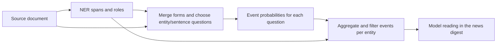

# News model training

New to the model work: read [model training: start here](model-training.md) first (what a model result can change, data handling, where jobs run, licences, open items).

This document explains what the news models learn, how their outputs become a document reading, and what evidence permits a model change. Runtime behavior belongs to [news models](../feature/watchlist-and-adverse-information.md#news-models); licensing and data boundaries belong to [ADR-0015](../adr/0015-licences.md) and [security and privacy](../feature/security-and-privacy.md). Training data, model files and detailed experiment records stay outside the repository, found through the `AML_*` environment variables of `tools/news-model/paths.py`.

## The system learns answers to two different questions

The NER model asks **which text spans name people or organisations, and what role each mention has**. The event model asks **which legal events a particular sentence states for the queried entity**. Recognising an event word, finding a name and assigning that event to the right person and case are separate tasks.

`OnnxNewsModel` supplies model inference. `NewsModelReading` chooses questions, merges forms and applies the runtime's entity/event rules. The digest is an attributed reading of the source; identity, source-condition and disposition decisions do not consume it.

The approved base is `bert-base-chinese`. The current NER label map has seven roles: `PER-Suspect`, `PER-Victim`, `PER-Official`, `PER-Other`, `ORG-Suspect`, `ORG-Victim` and `ORG-Other`, represented as BIO tags plus `O`. Canonical `PER-Witness` labels are merged into `PER-Other` by the training reader; a separately learned witness class is not currently available.

NER reads overlapping token windows. The retained candidate also learns document-level role biases from predicted mentions of the same source form. This can use an informative mention elsewhere in the document, but a person's overall role does not determine who owns a particular event or whether that event belongs to another case. Standalone NER acceptance uses final greedy spans with roles; runtime BIO decoding is evaluated through the complete pipeline.

The event model is a multi-label classifier. Its supported columns encode event types, certainty variants and `prior`. The ordinary input is `[CLS] form [SEP] marked sentence [SEP]`: crop 460 characters around the form, mark every occurrence of that form with IDs 1 and 2, then retain at most 512 tokens. Current NER inputs lowercase ASCII with an explicit model flag; ordinary event inputs retain their cased normalization. The two input modes must not be conflated.

### The question boundary controls what can be learned and found

Training preparation mirrors `NewsModelReading.Asked`: ask about a sentence containing an entity form; also carry one following sentence naming no person to the last-named person when that person is a suspect; and ask every suspect about each sentence that names no suspect (whole-case rows; in a judgment only the defendants listed before 主文). In documents with more than five suspects the label-free whole-case rows are sampled, about three per sentence, so they do not swamp training. The runtime also asks the unnamed suspects about a sentence naming one suspect for a group (等N人), and about any other sentence naming a suspect for investigation and referral only; no training row mirrors either yet. A gold event outside these questions contributes no event-training row. It can still be missed by the whole-document reader.

The runtime also merges forms, limits organisation events to applicable procedures and aggregates sentence probabilities per entity. A correct answer on an annotated row therefore does not guarantee a correct document reading. An extra NER entity can create extra questions and false events; a missed entity can prevent a correct event from being asked at all.

## Acceptance has three gates

All three gates must pass for the **same selected NER/event pair** on the fixed dev split. Each F1 must be strictly greater than 0.90.

| Gate | Unit being compared with gold | What remains in the denominator |
|---|---|---|
| Primary NER | Exact span boundaries **and role**, using the acceptance scorer's greedy decoding | All 3,031 original gold spans in 161 dev documents |
| Primary event | Label decisions on prepared entity-form/sentence rows | All dev rows the current asking rules produce (8,050 rows, 1,194 gold labels); unsupported gold labels count as FN |
| Actual end to end | `(document, gold person, event label)` through `OnnxNewsModel` and `NewsModelReading` | All gold events of the 161 dev documents; events on unlabelled entities count as FP |

`F1 = 2TP / (2TP + FP + FN)`. The strict gate is checked with integer counts: `2TP > 9(FP + FN)`. A rounded display of `0.90` is insufficient. Boundary-only NER scores, BIO-constrained diagnostics, training fit and masked-language-model loss answer other questions and cannot replace these gates.

**The unit of the working end-to-end measure is the written name.** Day-to-day comparisons score every annotated event of the dev documents and of the second dev set, at the runtime floor of 0.40. The reader's answer is per written name, so two rules decide who a read name is:

- a read name that is a fragment of exactly one annotated person's written form counts as that person;
- annotated persons whose written form is identical in the same document (two masked names written alike) are one name, and their gold events are the union. Nothing in the name tells them apart, and scoring them apart counts one unavoidable miss and one unavoidable false positive per event. Persons the text does tell apart, for example by a bracketed role after the same surname, stay separate.

These rules are part of the measure, not of the models: compare a number only with numbers scored the same way.

The primary event threshold is selected on dev over 0.05–0.95 in 0.025 increments. End-to-end calibration uses the runtime's effective 0.40 floor through 0.95 at the same increments. An outer evaluator threshold below the runtime floor cannot recover already-filtered outputs. Recount a probability dump first, then confirm its selected optimum through the actual .NET evaluator. Calibration is separate from a learned improvement.

Train is used for optimization, dev for checkpoint/threshold selection, and test for final validation. Keep split identities and held-out gold fixed during this improvement loop. Add eligible new sources to train only, excluding duplicate and related held-out material. If train labels change, compare both candidates on the same evaluation revision. Earlier test results belong to their historical model/data revisions; they do not validate the retained candidates. Final test remains reserved until all three dev gates pass together, then uses frozen model identities and dev-selected thresholds.

## Current candidate choice

The retained development choice is **NER20 / event43**. The repository ships no news models and sets no `NewsModels:Directory` (no default; without it the digest is read by rules alone); a deployment supplies that directory, and the model-gated tests read the one `AML_NEWS_MODELS` names. The retained pair's graphs are `AML_TRAIN/measurements/aml43-pair/` (see [where the artifacts live](#where-the-artifacts-and-entry-points-live)).

| Measure | Selected candidate | TP / FP / FN | Dev F1 | Threshold | Gate |
|---|---|---|---|---|---|
| Primary NER | NER20 with ASCII input mode and document-role head | 2,791 / 265 / 240 | 0.917036 | — | Pass |
| Primary event | event43, ordinary CLS input/output | 963 / 259 / 231 | 0.797185 | 0.40 | Fail |
| Working end to end, dev documents | NER20 / event43 | 508 / 64 / 69 | 0.884247 | 0.40 | Fail |
| Working end to end, second dev set | NER20 / event43 | 353 / 40 / 44 | 0.893671 | 0.40 | Fail |
| Working end to end, 40 court releases | NER20 / event43 | 139 / 28 / 77 | 0.725849 | 0.40 | — |
| Profile person, dev documents (176 persons) | NER20 / event43 | 450 / 106 / 50 | 0.852273 | 0.40 | — |
| Profile person, second dev set (125 persons) | NER20 / event43 | 294 / 71 / 7 | 0.882883 | 0.40 | — |

The two Profile-person rows measure the reading the way the system uses it: one known person per news item. Each labelled suspect person in turn is the Profile person (all their written forms are the Profile's names; persons sharing a form are one), the reader is run with those names, and only the entities it marks as the Profile's are counted. The legal stage those events imply (the highest of convicted, acquitted, not indicted, indicted, wanted, alleged, none; earlier-case, negated and requested steps left out) agrees with the labels for 161 of 176 persons (0.915) and 122 of 125 (0.976); whether the person has any step at all agrees for 170 (0.966) and 125 (1.000). This view has no gate. It is harsher on precision than the working measure (persons with no labelled event are included: 41 and 16) and it rotates only over labelled suspects, so it says nothing about a Profile person the text mentions as a victim or an official.

The event rows are those of the current asking rules (8,050 dev rows), so the primary event counts are not comparable with candidates measured on earlier row sets. The end-to-end rows use the working measure defined above, not the gate's form (one gold person per cell, without the two name rules); the gate form has not been re-measured for event43, and both working rows are already short of 0.90. The second dev set is 29 documents that are never used for training; the working rows are scored on the corrected gold (`review-current/fix`). Thresholds and reader rules were chosen looking at the dev sets, so neither is an untouched estimate; the test split is. In the working rows (the 40 court releases are the set the three court-release readings of the feature doc were designed on) the reader counts one person written several ways as one entity: a mask written ○, Ｏ or O, an anonymised form (王嫌, 王某) beside the one named person of that surname and role, and a name tagged one character too long. An anonymised form beside another of its surname with no name written for it, and a surname-only form shared by two suspects, stay apart on purpose. All rows are at the reader's listing bar of 0.40 with the reader rules of the feature doc in place. By form of text, the remaining dev errors sit mostly in sentences naming several suspects or one for a group (王○○等N人) and in two long documents (a judgment with twenty suspects, a group case with eight). On the 40 court releases 79 of 92 misses sit in two releases, of 22 and 13 defendants: the first's are of ownership (one sentence naming many persons), the second is a table, one cell a line, which no text rule reads without the source page's table structure. The legal stage the system gives does not come from the news models: the stage rules and the two stage models vote on it ([Stage from attached news](../feature/watchlist-and-adverse-information.md#stage-from-attached-news)), measured on court-release sets of their own ([stage model training](stage-model-training.md#measured-sets-and-their-boundaries)).

An overall passing NER score does not establish reliable rare roles: `ORG-Victim` has zero TP on six dev gold spans. Model-role accuracy and event attribution both matter to the final reading.

### What the retained pair was trained on

event43 is event37 continued one epoch at the same settings on the `data-r8` event rows (173,941 rows, 15,683 of them with at least one label, 20,183 row labels; the rest are the label-free questions the reader asks at run time), with four later label edits in two training documents, plus 539 made-up court-report questions (`data-synth/train-a/b/c.jsonl`) repeated four times: 176,097 rows. job43 took the rows from `data-r11` without its 21,521 `caseonly` rows, which equals `data-r8` with those edits; `tools/news-model/build_job.py` rebuilds it that way and the README gives the hash to check. event37 is the job35 event model (the `data-r8` rows, two epochs from event32) continued one epoch at learning rate 1e-5 with the asked name masked in half the rows. Each job's trained weights are its last-epoch checkpoint, and its `job.json` records the hashes of its inputs. The made-up rows and the court press-release rows (`data-court/train.jsonl`; the eight releases of `heldout.jsonl` are a measure, never trained on) are kept beside the document rows, not merged into them. NER20 is the 2026-11-14 round's rows with the document-role head ([tools/news-model](../../tools/news-model/README.md)).

### What was tried and left out

Each line is a decision with its evidence, measured on the candidate of its time (error counts over both dev sets on the working measure unless stated); repeat one only with a new observation that makes a materially different result possible.

| Tried | Measured | Decision |
|---|---|---|
| Made-up rows of a missing kind of text: court-report sentences on appealability (可上訴) and dated earlier steps of the same case | held-out made-up rows F1 0.761 → 0.864 at 0.30; dev errors 252 against 260 for the same extra epoch without them (job41) | **retained** (event43): the rows, not the epoch, gave the gain |
| 40 court press releases as training rows (event44; 32 train, 8 held out) | held-out release rows F1 0.742 against 0.727; dev errors 251 against 252; the stage agrees for three fewer Profile persons | not retained: no dev gain; the release errors are of reading and ownership, not of rows |
| Joining wrapped lines (`PdfText.Unwrap`) before reading | 40 releases 0.692 against 0.681, dev sets unchanged; of 18 hard-wrapped judgments 15 are tables | used on a received PDF page (`WebPages.ReadAsync`), not on an attached news text and not in `e2e.sh` (the evaluator's `unwrap` option only): no lever for the dev measures |
| Wrapping the sentence's other persons in a second marker pair (job36) | 271 against 276 errors, within one run | not retained; it would also change the served input |
| A different encoder (`jhu-clsp/mmBERT-base`) | 0.872 / 0.881 end to end; 173 errors shared with the CLS line, most of the shared misses steps stated only by a whole-case or group sentence | measurement only: its pre-training text and tokenizer fail [ADR-0015](../adr/0015-licences.md); a survey of about twenty encoders found none both stronger than `bert-base-chinese` and clean-licensed |
| Other steps from whole-case sentences in a large case when the model is very sure | at 0.9, 26 wrong events on the second dev set for none found | left out |
| A group sentence's steps for all suspects | the dev misses found, about forty wrong events added on the second set | left out |
| Dropping an answer whose sentence lacks its step's trigger word; adding a step wherever its word stands | row F1 0.814 → 0.790; 3,520 wrong answers for 134 right | left out: the errors are whose step and which case, not whether a step is written |
| A judgment's order read by rule for steps other than fine and confiscation | nothing more found | only the fine and confiscation are read by rule |
| Joining touching spans; the rule digest's role word over the tagger's; the rule events added to the model's; 前科 / 累犯 / 曾因 patterns for prior records | each worse or nothing more | left out |
| A role vote weighted by probability | one more role right in 443 | not worth the code |
| A threshold per label | tuned on dev it overfitted (dev up, test unchanged) | one bar, 0.40 |
| One certainty per type and sentence; events only for suspects, for anyone but officials, or for entities mentioned twice | no change or within noise | left out |
| Carrying over two or more sentences, or further only into sentences with a referring word (被告, 其, 他, 該男) | no gain, worse at eight sentences | one sentence carried |
| Whole-case steps for the Profile person without an event of their own | first dev set up, second down (steps given to persons the text only mentions) | left out |
| 2,000 classifications per article instead of 1,200 | no result changed | 1,200 |
| int8 quantization; ONNX Runtime's BERT graph fusion; padded batches of event questions | 1.2× faster with fewer people found (no VNNI on the CPU); no faster; slower on a CPU | left out |
| One encoder pass for tagging and events | end-to-end F1 lower, fewer people found, only 23 % faster | left out |

Structural candidates measured so far (document-context heads, trigger-binding supervision, caption observation, shared predicate decoder, clause-level rows, other-person markers) did not replace the ordinary CLS line. The five source-reviewed actor/case errors that motivated the earlier structural work have not been re-checked against the current candidate. Current selection and limitation summaries belong here; epoch histories, process IDs, upload progress and individual retry records belong to the external artifacts.

## Diagnose an error at the boundary where it arises

Start with the source and canonical label, then trace the exact runtime question and retained token IDs. The following distinctions determine which correction would address the error.

| Question | Evidence to inspect | Consequence for a correction |
|---|---|---|
| Is the gold statement correct for this person, event, certainty and case? | Canonical annotation and source-reviewed ownership/scope | Correct confirmed label errors before training; a structural checker alone cannot certify semantics |
| Does the reader ask the necessary question? | `Asked`/`prep.py` parity and entity matching | Missing questions or entities require preparation/runtime or NER work; an event-loss change cannot create them |
| Does the model receive the distinguishing information? | Actual cropped IDs, segments, markers, normalization and source context | Repair demonstrated information loss while preserving offsets and label alignment |
| Does available context belong to the queried person and case? | Clause ownership, quoted statements, current/other-case references and retained context | Event-word detection and a global suspect role are insufficient; verify the relation itself |
| Does the model fit train but fail on dev? | Full-train and dev counts on their recorded revisions; error groups and case coverage | Investigate generalization and supervision coverage before proposing more epochs or a loss weight |
| Does a new component actually affect served predictions? | Gradients, zero-effect compatibility, controlled interventions and native/ONNX/.NET parity | Establish implementation correctness separately from semantic improvement |

### What the existing evidence establishes

**Exact input collisions are a small limit.** Identical encoded inputs with contradicting labels bound dev F1 at 0.998549; only four FP and no FN of event27 fall on such cells. The bound is not attainable performance, nor proof that each input holds enough case context.

**The event gap includes generalization.** event26 fits its train revision at F1 0.979608 (`prior` 412/415 TP) while dev `prior` stays 26/83 TP: not a failure to fit the labels. Negative-label prevalence alone does not show that loss weighting would repair the errors.

**Case-pattern supervision is sparse in the model views.** No prior-positive train row retains a named-case alias (17 dev positives do); a witness-prefix probe finds two train and five dev prior positives. These probes are inspection aids, not rules for `prior`. Replacing a reviewed other-case alias with an explicit other-case term did not improve full-dev F1. Six cached, unadopted sources have no alias hits; their eligibility and review are incomplete.

**Connecting more inputs or objectives does not by itself repair relations.** Document-context heads and a source-caption observation use their inputs and change probabilities, yet leave the reviewed actor/case errors. Trigger-binding supervision already updated the main encoder, so it was not a frozen-encoder bug (event25's saved weights were its epoch-zero selection, so they say nothing about the trained epoch), and serving the supervised predicate-token scores (event29) still leaves all five motivating errors wrong.

**The remaining errors are largely the same cells from one candidate to the next.** 256 of event37's 276 errors are the same person-and-step cells as its parent's, and 82 of the 142 persistent false positives are above 0.8 in both; retraining, more documents of the same kind and thresholds move only low-margin cells. End-to-end precision is 0.84–0.87 whether the sentence names the person alone, several suspects or not the person, so no sentence kind holds the gap. Of the false positives about three in ten are another named person's step, one in seven a step given to a person the sentence does not name, and nearly half an extra step type beside the person's own.

**Ownership inside a sentence is learnable only when the step word's position is given.** A pilot classifier (jobs 38, 39) asked per sentence, step type and named suspect ranks owners above non-owners with AUC 0.89 / 0.86 when the gold step words are marked, and as a dev-tuned filter removes 17 of 23 wrong ownerships for 6 of 134 right ones; given the step type only, 0.82 / 0.75 and almost no filtering. The marked positions are oracle: using it needs a run-time step-word finder, which does not exist, its reach is bounded by the three-in-ten share above, and a form shared by two persons must be resolved first.

**Restated steps are not a systematic label gap.** Of 227 training rows (sentence, step type, named suspect) where the suspect lacks a step that the same text records for that person elsewhere, two independent checks and a source reading led to four label changes. About half of the labelled step owners are not named in the step's sentence; those depend on the asking rules, not on sentence-internal reading.

These findings support continued work on person/event/case relations and train-only coverage. They do not establish that one vocabulary change, wider crop, threshold adjustment or parameter combination is the remaining solution. A proposed correction needs a source-verified failure mechanism and a test that distinguishes repaired behavior from merely changed confidence.

## Treat a candidate as a complete inference contract

A candidate consists of weights, feature configuration, label maps, tokenizer behavior, learned heads, runtime behavior and its evaluation revision. A weights filename alone does not identify the predictions.

| Boundary | Invariant |
|---|---|
| Preparation → training | Preserve row identities, labels, order and split provenance. Use every original primary row, including negatives and rows without auxiliary supervision |
| Feature mode → inference | Normalization, crop, markers and document-derived observations must agree in Python and .NET. An effective input change needs a compatibly trained checkpoint and measured parity; compare actual IDs rather than treating serialization-only JSON differences as a new tokenizer |
| Training → evaluation | Explicitly enable training/dropout for optimizer batches; preserve mode across dev evaluation. No dev augmentation. Check real finite gradients and parameter updates |
| Auxiliary supervision → primary task | Unknown/ambiguous trigger ownership supplies no auxiliary target; it does not turn a primary positive into a negative or remove its row |
| Checkpoint → report | Record the selected epoch, epoch-zero baseline and actual final trained weights separately. Selection of epoch zero is not trained improvement |
| Native → ONNX → .NET | Compare real short/long inputs, padding and boundary cases, outputs and exact tokenizer IDs. Test the complete runtime path, not only a synthetic export |
| Model → cache | Bind caches to model/config/feature identity. Document-dependent event modes also require the source-document identity; a pair-only key cannot represent them |

The retained event model uses ordinary CLS pooling. Experimental contracts are available for document-context heads, literal caption observations and query-conditioned predicate-token pooling. Their flags and graphs describe different computations; the runtime support does not make them selected models. The predicate decoder uses existing BERT/pooler/classifier parameters, excludes query/name/delimiter/padding positions from the predicate pool, and retains a fallback for an empty pool. Its training-only trigger bindings are conservative source alignments, not runtime gold inputs.

Native event inference goes through `event_pooling.event_logits`, which dispatches the saved pooling mode. Loading ordinary `BertForSequenceClassification` weights and calling its default forward does not automatically apply an AML-specific decoder. `export_one.py` uses the matching export wrapper; the generic .NET graph runner then executes the exported computation.

Known unsuccessful mechanisms remain evidence against repeating an unchanged proposal. Preserve their immutable sources and results, and state what new observation would make a materially different experiment informative.

## From a diagnosis to a reviewable model change

1. **Validate the source and proposed correction.** Annotate → independent verify → targeted sweep use different subagents under the authorized review scope; every label file passes `check.py`. Preserve source fingerprints and resolved disagreements. Apply confirmed train corrections before rebuilding. Reports contain anonymous document/party IDs and counts, never source names or quotations.
2. **Freeze the comparison.** Record starting weights, exact train/dev inputs, label maps, split and code hashes, settings and the intended failure cases. Reproduce the parent's complete dev counts before optimizer creation. When a feature mode changes, measure its untrained initialization separately from the ordinary parent.
3. **Exercise the real path.** Check the actual tiny training entry, gradient paths, save/reload, row retention, unsupported-label misses and export/runtime parity. An isolated real-GPU preflight proves finite updates, active training/dropout and unchanged parent/input files before formal optimization. Synthetic learning validates machinery, not task F1.
4. **Train and preserve artifacts.** Optimize on train and choose on fixed dev. Save per-epoch probabilities with gold/label order, selected and last-trained checkpoints, logs, sources and manifests. Run the job with `tools/colab/run_job.sh`, which watches it and downloads what exists before any stop; run no second watcher or launcher beside it.
5. **Decide on measured behavior.** Independently reload and score the selected model; compare identical gold arrays, recovered/lost TP and removed/added FP. Export and evaluate the actual paired .NET reader with an isolated cache, then confirm the dev optimum. Revisit the motivating source errors. Retain the better measured candidates, and accept a pair only when all three gates pass. Deployment is a separate action.

The next experiment follows from unresolved evidence. A low aggregate score or a stagnant sequence of runs does not, on its own, justify another epoch/learning-rate/loss trial.

### Colab is temporary execution, not durable storage

The container, sign-in and session rules are those of [tools/colab](../../tools/colab/README.md) and [where it runs](model-training.md#where-it-runs). A job stages only the permitted inputs and pins the tested environment in `run.sh`; no test-split input is uploaded.

A job is built with `tools/news-model/build_job.py` and run with `tools/colab` (`colabjob.py package` / `check`, `run_job.sh <name> T4 <download dir>`; skill `colab-job`). A new trainer's processes must be named in `--alive` and its results listed for download. The runner fetches the results in parts and checks md5 per part and SHA-256 of the join before extracting, then stops the session. Inspect selected/last weights, sources and epoch arrays independently. Interrupted snapshots and aborted jobs retain distinct receipts and must not masquerade as completed results.

A local observation timeout is not evidence that training ended. Recheck the same worker/session and advancing steps rather than starting a replacement job. An interim checkpoint backup needs its own identity and must not set the final completion/stop markers. Preserve existing job directories and manifests when preparing another experiment.

## Where the artifacts and entry points live

The pipeline that rebuilds the retained pair's data, jobs, ONNX export and scores is in `tools/news-model/` (data locations from `AML_DATA`, `AML_TRAIN`, `AML_EVAL`, `AML_COLAB_HOME` in its `paths.py`; jobs run with `tools/colab`; skill `news-models`); its README says which script reproduces which step and what cannot be rebuilt from today's labels. The other locations in this section are data and evidence outside the repository, under the two roots `AML_DATA` and `AML_TRAIN` and the evaluator's `AML_EVAL`. They distinguish source truth, derived inputs, candidate artifacts and deployed files; directories named `models/ner` or `models/ev` are not sufficient evidence of which candidate was selected.

| Responsibility | Location |
|---|---|
| Reusable pipeline (rows, job bundles, trainers, export, scoring, end-to-end wrapper) | `tools/news-model/` (`prep.py`, `build_job.py ev\|ner` (checks the bundle while building it), `export_one.py`, `measure_dev.py`, `gold_merge.py`, `e2e.sh`) |
| Source texts | `AML_DATA/judgments/`, `press/`, `news/` |
| Canonical labels | `AML_DATA/labels/v6/ver`, `v6/npa/fin`, `v7/ver`, `v8/ver`, `v9/ver`, `v11/ver` (train only from v7 on), dev corrections in `review-current/fix`; second dev set `v10/ver` |
| Annotation guideline/checker | `AML_DATA/labels/tools/guideline.md` (the guideline of record; rule 45 labels a step only when stated: implied steps are not labelled; another case's step is at most a prior; a step stated for a group goes to each member the sentence or its context ties to it, and to no one else), `check.py` and review prompts |
| Fixed splits and derived model rows | `AML_TRAIN/data-r8/` (`split.json`, `ner-{train,dev,test}.jsonl`, `ev-{train,dev,test}.jsonl`), `data-r11/`, `data-r12/` (`prep.py` rounds); second dev set `data-dev2/` |
| Preparation, trainers, native scorers and Python checks | `AML_TRAIN`, interpreter `AML_PY` (default `AML_TRAIN/.venv/Scripts/python.exe`) |
| Colab staging | `AML_COLAB_HOME`; immutable `job<N>/` bundles |
| Downloaded weights/logs and verification receipts | `AML_TRAIN/downloads/colab-20261114/` (jobs through 29), `downloads/aml<N>/` (later jobs) |
| Metrics, diagnostic arrays and isolated runtime pairs | `AML_TRAIN/measurements/` |
| Immutable executed source snapshots | `AML_TRAIN/snapshots/` |
| Actual .NET evaluator | `tools/Aml.NewsEval` (built with the solution); its working folder `AML_EVAL` (or `out=`) holds its documents and the dumps it writes |

The retained native NER is `downloads/colab-20261114/aml20/ner/extracted/models/ner`; it requires both its encoder and `document-roles.safetensors`. The retained native event model is `downloads/aml43/models/ev`. Their ONNX/config/vocab pair and isolated caches are under `measurements/aml43-pair/`. These paths are relative to `AML_TRAIN`. Older appliers and experiment launchers kept there are historical programs: generic preparation and older experimental trainers may rebuild held-out files or read test automatically, so inspect their side effects and pinned inputs before running one.

Deployment supplies the matching `ner/` and `ev/` graphs, configs, vocabularies and required heads at `NewsModels:Directory`. Update the product's measured behavior with the deployed pair. A change to `NewsModelReading.EventThreshold` changes the inference contract and requires actual runtime evaluation as well.

| Task | Existing entry point and boundary |
|---|---|
| Rebuild derived inputs | `prep.py`; preserve fixed splits and use guarded train-only rebuilds for train label revisions |
| Verify a completed download | `run_job.sh` checks md5 per part and SHA-256 of the join before extracting; historical receipts were written by `verify_completed_run.py` (outside the repository) |
| Score native dev models | `measure_dev.py <model> <checkpoint> <out>` (the experimental predicate, caption and document-context modes are not carried over and stop with an error) |
| Export a checkpoint | `export_one.py <checkpoint> <out>`; verify graphs, config and vocabulary together, including required learned heads |
| Evaluate the whole reader | Release `Aml.NewsEval.dll <pair> dev cached e2e min=<threshold> cache=<isolated-cache> idsref=<reference> dump=<file>` (modes in [tools/news-model](../../tools/news-model/README.md#the-evaluator-toolsamlnewseval)) |
| Working end-to-end measure on both dev sets | `bash tools/news-model/e2e.sh <tag> <pair>`: builds the evaluator, scores the dev documents and the second dev set at 0.40 and prints the fragment score and the default measure |
| Final per-model test | `measure_dev.py <model> <checkpoint> <out> --split test --dev-metrics <passing-record>`; use only after all three dev gates pass |

Here `<model>` is `ner` or `ev`. Run Python tools from `AML_TRAIN`; the .NET evaluator works in `AML_EVAL` and uses the `dev.jsonl` there, derived from the same fixed dev revision. Shell commands follow the repository's RTK instruction.

New end-to-end probability dumps contain numeric fields, anonymous IDs and an empty quote column; unknown entity IDs are hashed per document. Working inference caches still contain private input text and stay outside the repository. Reuse a NER cache only under matching NER/input/role-head identities. Event changes start with a fresh isolated cache; document-dependent modes include the document in their key.

### Evidence index

These are durable references for conclusions above, not a second execution log. Paths are relative to `AML_TRAIN/measurements` unless they start with a root.

| Question | Evidence |
|---|---|
| Which candidates and actual pipeline are retained? | `aml20-ner/ner-dev-metrics.json`; `AML_TRAIN/downloads/aml43/logs-ev.txt` and `job.json`; `aml43-pair/` scored with `e2e.sh` (working measure) and the evaluator's `profile` mode |
| Do rows of a missing kind of text help, and which kind? | `AML_TRAIN/data-synth/` (brief, rows, blind relabels) and `AML_TRAIN/data-court/`, scored with `score_rows.py`; controls `aml41-pair/` (epoch without new rows) and `aml44-pair/` (court press releases); `AML_TRAIN/data-court/heldout-err44.jsonl` for what stays wrong |
| How do the model and the stage rule read court press releases end to end? | `court/` (`evaldocs.py` writes the evaluator's `docs.jsonl` for the 40 releases, `gold_merge.py` scores a dump); evaluator with `docs=…` in `e2e` and `stage` mode, `unwrap` to join wrapped lines first. Stage sets: label rounds `AML_DATA/labels/v13/` → accept, `v14/` → accept3, `v15/` → accept4, `v16/` → accept5 (held back), two blind passes each with `tools/labels/stage-brief.md`, merged by `tools/labels/merge.py` and turned into evaluator documents by `court/accept*.py`; their use and counts in [stage model training](stage-model-training.md#measured-sets-and-their-boundaries) |
| Did marking the other persons of the sentence help? | `aml36-pair/` against the control `aml37-pair/` (same start, epoch count and settings, no markers) |
| Which cells stay wrong from one candidate to the next, and in what kind of sentence? | `audit-e2e31/cmp35.py`, `audit-e2e31/kind37.py` on the evaluator's dumps; the small failing-case set in `aml29-ev/actor-case-diagnostics.json` |
| Can ownership inside a sentence be learned, and what must be given? | `AML_TRAIN/prep_pairs.py`, `pilot_pairs.py`; `AML_TRAIN/downloads/aml38/` (step words marked), `downloads/aml39/` (step type only); `audit-e2e31/pairbase.py` for the sentence model on the same rows |
| Are restated steps missing from the labels? | `AML_DATA/labels/review-20261118q/` (items, two blind checks, applied changes, backups) |
| Is the event gap mostly identical-input contradictions? | `input-identity-audit/encoded-conflicts.json` |
| Does the model fit the recorded training revision? | `aml26-ev/train-fit-diagnostic.json` and its probability array |
| What case-pattern coverage is missing? | `input-identity-audit/case-frame-coverage.json`, `input-identity-audit/named-case-alias-intervention.json`, `input-identity-audit/uncatalogued-literal-coverage.json` |
| Does adding document context solve attribution? | `aml21-ev/context-head-analysis.json`; context variants in `aml22-ev/` and `aml23-ev/` |
| Was trigger supervision disconnected or the saved checkpoint actually trained? | `aml25-ev/completion-analysis.json`; archived trainer/logs under `AML_TRAIN/downloads/colab-20261114/aml25/ev/` |
| Does the literal caption observation repair case relations? | `aml28-ev/completion-analysis.json`, `aml28-last-ev/caption-intervention.json` |
| Does serving the supervised predicate score repair them? | `aml29-ev/completion-analysis.json`; implementation checks in `query-predicate-validation/` |
| Are the model/data/runtime identities reproducible? | Each job's `job.json`, `VERIFIED.json`, `artifact-validation.json`, GPU receipt and per-epoch arrays; executed-source snapshots (training, scoring, export, Colab scripts, the .NET checkers, with SHA-256) under `AML_TRAIN/snapshots/` |

The licence review covers both replacement weights and their training corpora. Metadata reviews under `AML_TRAIN/candidate-review/macbert-base/` and `candidate-review/bert-wwm/` do not constitute approval or a base-model replacement; ADR-0015 remains the decision in force.
